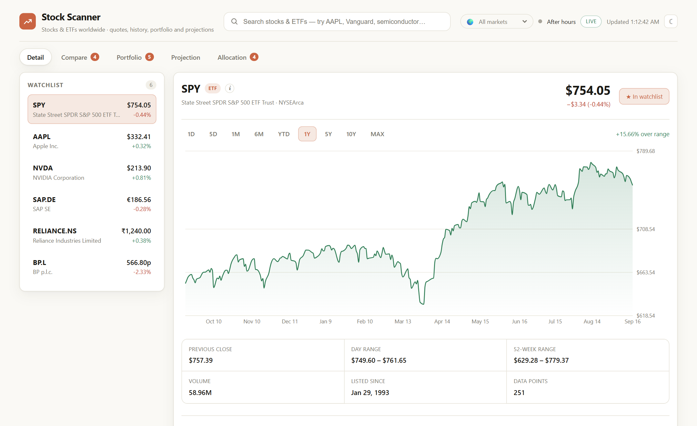

# Stock Scanner

**Watchlist, portfolio, projections and allocation for stocks and ETFs worldwide — all in one
browser tab.** No account, no server, no API key, nothing collected. A viewer, not a broker: it
never touches money.

[**stockscanner.pages.dev**](https://stockscanner.pages.dev) · MIT licensed



Everything runs inside your browser. Your watchlist, holdings and cost basis live in extension
storage and nowhere else; the only network requests go to Yahoo Finance for prices. There is no
analytics, no error reporting and no telemetry of any kind — which is checkable, because this is
the code that gets built and submitted.

It began as a local web app with a Node proxy in front of Yahoo Finance, because a web page
cannot call those endpoints directly: they send no `access-control-allow-origin` header, so the
browser refuses the response. An extension is exempt from that rule — host permissions grant it
cross-origin access — which removed the entire reason the server existed.

## Install

**Firefox** — from [addons.mozilla.org](https://addons.mozilla.org), once review passes.
Firefox treats host permissions as opt-in under Manifest V3, so the first open shows a single
button asking for access to Yahoo Finance. Nothing loads until you grant it; nothing else is
ever asked for.

**Chrome** — not on the Web Store (that costs a one-time $5 developer fee). Load it yourself:

1. `npm install && npm run build`
2. Open `chrome://extensions` and turn on **Developer mode** (top right)
3. **Load unpacked**, and select the **`dist`** folder — that folder is the extension
4. Click the toolbar icon to open the dashboard in a tab

Rebuild after any change, then press **Reload** on the extension card.

## Publishing

```bash
npm run package
```

Builds once and writes two archives to `build/`, differing only in the manifest:

| | Difference |
| --- | --- |
| `stock-scanner-chrome-*.zip` | `background.service_worker`, as Chrome's MV3 requires |
| `stock-scanner-firefox-*.zip` | `background.scripts` (Firefox MV3 uses an event page and rejects a service worker), plus `browser_specific_settings.gecko` |

Upload the Firefox one at [addons.mozilla.org/developers](https://addons.mozilla.org/developers/).
Submitting is free and the review is usually quick for an add-on with no remote code — which
this has none of, since everything is bundled at build time.

**Before the first submission**, set a real add-on id in `scripts/package.mjs`. It defaults to
`stock-scanner@example.org`, and whatever the add-on is first accepted under is permanent.

The archives are written by `scripts/zip.mjs` rather than a system tool, because the obvious
Windows one — PowerShell's `Compress-Archive` — writes backslashes as path separators, which
violates the spec and unpacks flat everywhere else. An add-on store is the wrong place to
discover that.

## Permissions, and why each one

| | Why |
| --- | --- |
| `storage` | Your watchlist, groups, holdings, comparison and theme. Nothing else uses it. |
| `query1/query2.finance.yahoo.com` | Quotes, candles, search, company profiles, option chains. |
| `fc.yahoo.com` | Issues the session cookie that option chains require. |

That is the whole list. In particular it does **not** ask for `tabs` — reusing an already-open
dashboard tab would normally need it, which users read as *"read your browsing history"*, so
the extension remembers the tab id in session storage instead.

It reads no page you visit, injects no content script, and talks to no host but Yahoo.

## What it does

- **Search** — by ticker or company name (`AAPL`, `Vanguard`, `semiconductor`). Arrow keys
  and Enter work; results are debounced by 250 ms.
- **Watchlist** — click a result to open it, star it to pin it. Saved to extension storage
  (see *Where your data lives*). Starts with SPY, QQQ, AAPL, NVDA, VOO.
- **Live quotes** — every 15 s, paused automatically when the tab is
  hidden, and pausable with the Live toggle. The header shows whether the US market is
  currently open.
- **History** — 1D, 5D, 1M, 6M, YTD, 1Y, 5Y, 10Y and MAX. Intraday ranges use 2-minute
  candles; MAX uses monthly ones. Closes are split- and dividend-adjusted, and the chart
  shows the percent move across the visible range.
- **About panel** — under the chart, what the thing actually is. For a stock: the business
  summary, sector, industry, headcount and company site. For an ETF: the provider, category,
  expense ratio, its ten largest holdings and its sector mix. Holdings are clickable, so
  QQQ → NVDA opens NVIDIA's own page. Each panel links out to the full Yahoo Finance profile.
- **Compare** — up to 8 tickers overlaid on one chart, each indexed to 0% at the start of
  the range, so you read relative performance instead of unrelated share prices. Toggle
  tickers from the watchlist chips, or search to add anything else; the ranked table below
  the chart sorts by return over the range. A symbol that listed partway through the range
  (say ARM over 5Y) simply starts its line at its IPO.
- **Portfolio** — you enter what your broker shows, and the app works out the rest. Per holding
  there are three numbers to type:
  - **Buy price** — the price per share your broker charged.
  - **Fee** — the broker fee for that buy.
  - **Total paid** — all the money you paid, fee included.

  You never type a share count. Yahoo's price and your broker's price are not the same, so a
  share count worked out from Yahoo would be wrong. Instead:
  `shares = (total paid − fee) ÷ buy price`. Fractional shares are fine (savings plans).

  Example: Apple on XETRA, buy price 300,40, fee 1, total paid 1001 → 3.3289 shares.

  **Price now** starts at your buy price and then moves with the market, by Yahoo's change since
  then. So right after buying, your gain is minus the fee — not a made-up profit from the gap
  between Yahoo and your broker. If you bought earlier, or want to match your broker exactly,
  type the price your broker shows now; it follows the market from there. Yahoo's price is
  shown small under it for reference.

  There is no "today" column: a daily move from Yahoo does not match your broker's prices, so
  the tab shows only what counts — value, total paid, and gain or loss.

  `value = shares × price now`, `gain = value − total paid`. Totals are kept per currency,
  with an allocation donut for each. Numbers can use a dot or a comma for decimals (`612.45`
  or `612,45`), and thousands marks are fine too (`1,234.56` or `1.234,56`). Holdings saved
  before this change are converted: buy price = old cost, total paid = shares × cost, fee 0.
- **Removing a holding** — the × at the end of each row. It stays pinned at the right edge, so
  it is visible even when the table has to scroll on a small window.
- **Projection** — "if I invest $X today, there's a P% chance it's worth at least $Y in Z
  years", with a fan chart of percentile bands, a table of outcomes, and a reverse mode that
  takes a target value and returns its odds. See the caveats below.
- **Watchlist-wide comparison** — inside the Projection tab, runs the identical fit across
  every watchlist ticker for one amount and horizon, with past return, volatility, worst
  historical fall, downside/median/upside and chance of loss in sortable columns. It is a
  comparison instrument, not a ranking of what to buy: nothing is sorted by outcome until
  you ask, no row is highlighted, and rows fitted above 25%/yr growth are flagged as the
  model breaking down.
- **Allocation** — split a lump sum across 2–8 holdings and see what that split could become.
  Sliders set the weights (shown as both a percentage and a cash amount) and buttons fit them
  to a named objective; the outcome table then gives the range of values the money could reach
  over the chosen horizon. Unlike the other tabs this one models the holdings *together*,
  using their covariance, so the volatility it reports accounts for how much (or how little)
  diversification the mix actually buys. See below.
- **Themes** — a warm off-white light theme by default, plus a dark variant sharing the same
  palette. The choice persists and is applied before first paint, so there's no flash.
- **Groups** — split the watchlist into named groups, like *India*, *Europe*, *EUR* or *Tech*.
  Pick a group above the watchlist and every tab shows only that group: the watchlist, the
  Compare and Allocation chips, the Projection table, and the Portfolio rows and totals. Pick
  **All** to see everything again. See *About groups* below.
- **Backup & move** — the button at the right of the tab bar. Save your setup to a file (or copy
  it as text), then load it on another computer. See *Moving to another computer* below.


## What this is not

It is a **viewer**. It reads public market data and draws it, and there is no path through this
extension by which money could move — none of the machinery exists.

- **No brokerage connection.** It links to no broker, bank or exchange account.
- **No trading.** There is no buy or sell button; it cannot place, cancel or route an order.
- **No payments.** It never asks for card, bank or wallet details.
- **No credentials.** No logins to anything. The only permission beyond the price feed is
  browser storage.

Holdings typed into the Portfolio tab are notes to yourself — numbers the app multiplies by a
price. They are not a position, not linked to any account, and visible to nobody but you.

## What this is for

Stock Scanner is **for information only**. It makes no promise about the future, and nothing
in it should be read as one.

Everything it shows starts from prices that have already happened. The projection tab fits a
mathematical model to that history and draws the range of outcomes the model allows — a spread
of possibilities, not a prediction, and not a claim that any of them is likely. The allocation
fit buttons score weights on how these tickers moved in the past, which is a description of
history rather than a recommendation about what comes next.

Real markets have fat tails, crashes and regime changes no lognormal model reproduces. The
figures ignore fees, taxes and inflation. There are no buy or sell signals here, no portfolio
advice and no opinion on any ticker.

Not investment, financial, tax or legal advice. It shows you numbers; what you do with them is
yours.

## Notes and limits

- Yahoo's endpoints are undocumented and unofficial. They're fine for personal use but have
  no uptime guarantee — if quotes stop arriving, Yahoo changed something, not your setup.
  Quotes are real-time-ish for most US listings and can lag up to 15 minutes.
- Caching keeps the request rate low: 5 s for quotes, 15 s for intraday candles, 10 minutes
  for daily candles, 5 minutes for search.
- The market-open indicator uses regular US hours in Eastern time and does not know about
  market holidays.
- Trading hours are known for 51 exchange calendars, each read in its own local time —
  including the midday break Tokyo, Hong Kong and Shanghai keep, and the Sunday-to-Thursday week
  in Tel Aviv, Riyadh and Dubai. An exchange not in that table falls back to New York hours.
  Public holidays are not modelled anywhere.
- Search covers every listing Yahoo indexes, not just US ones. An exchange suffix identifies
  the market: `.DE` XETRA, `.L` London, `.PA` Paris, `.AS` Amsterdam, `.NS` NSE, `.BO` BSE.
  The same company often has several — `SAP`, `SAP.DE` and `SAP.F` are one business on three
  exchanges, in two currencies.
- Prices show in the currency the exchange quotes in. London quotes in **pence** (`GBp`), not
  pounds, and is displayed that way rather than silently divided by a hundred.
- Option chains, and therefore implied volatility, are effectively US-only. Elsewhere the
  projection tab falls back to historical volatility on its own.
- Not investment advice.


## Data provider

Everything comes from Yahoo Finance's public endpoints. No key, no signup, no quota page.

They are undocumented and unofficial, which is the trade: free and complete — quotes, years of
candles, company profiles and full option chains — with no uptime guarantee and no terms
covering redistribution. Personal use from your own browser is squarely what this is.

Requests come from **your** connection, which matters more than it sounds. Yahoo throttles
datacenter IP ranges far harder than home connections, so the same code that thins out when
deployed to a cloud host runs cleanly here.

Everything reaches Yahoo through `src/data/market.js`. No view calls a vendor directly, so a
different source means rewriting that one file rather than hunting through the app — which is
the seam a licensed feed would slot into if this ever needed one.

## About the allocation tab

This is the only tab that treats holdings as a *portfolio* rather than a list. Two details
matter:

- **Returns are combined as simple returns, not log returns.** A portfolio's return is the
  weighted sum of its holdings' simple returns; weighting log returns would be quietly wrong.
  The server therefore supplies arithmetic annual means and an annualised covariance matrix,
  and the client converts back to a log-drift (`ln(1+μ) − σ²/2`) only at the point of
  projecting, so this tab and the projection tab agree.
- **Volatility comes from the covariance matrix, never from averaging.** A mix of two assets
  correlated at 1.0 is exactly as volatile as its parts; at 0.2 it is far steadier. The gap
  between a mix's actual volatility and the weighted average of its parts is the
  diversification it buys, and the tab reports that number directly.

### The fit buttons

Three buttons set the weights to the optimum for a **named** objective, because "best" is not
one thing:

| Button | What it maximises | Typical result |
| --- | --- | --- |
| Most return per risk | past return ÷ volatility | concentrated, but mixed |
| Steadiest | lowest volatility | often a single broad fund |
| Highest past return | return alone | always 100% in one holding |

They use hill-climbing from fixed starting points — the equal split plus each single-holding
corner — which lands on the actual optimum and, because the starts are fixed, returns the same
answer every press. Random restarts were measurably non-reproducible and were removed for that
reason.

Two of the three objectives usually collapse into a single holding. That is not a bug — it is
what optimising on past prices does, and it is worth seeing.

### What the buttons are not

The result is fitted to whatever **Measured over** happens to be set to, and the tab no longer
labels that anywhere — the window selector is the only clue on screen. On one basket of US
large caps, "most return per risk" put **62.7%** in NVDA on a 5-year window and **44.0%** on a
10-year window: a $4,675 difference on $25,000, from nothing but the choice of window.

So a fitted split answers "what would have worked", exactly and reproducibly. It cannot answer
"what will work", and on this evidence the two differ by more than the gap between the
holdings themselves.

The tab once carried an out-of-sample panel measuring this directly — fitting the best mix on
the first half of the window and holding it through the second. It was removed at the owner's
request along with the other explanatory sections, leaving the tab as a calculator. The result
it reported is worth recording: on a 5-year lookback the optimised mix stayed **7.2 points
ahead** of an equal split, while on a 10-year lookback it came in **3.8 points behind**. Same
method, same assets, opposite conclusion. `outOfSampleCheck` in `src/data/portfolio.js` was
deleted with it, so restoring the panel means restoring that function too.

Correlations are also assumed stable, when in practice they converge towards 1 in a crash —
precisely when diversification is meant to help.


## About the projection tab

The server fits a lognormal (geometric Brownian motion) model to the ticker's own history:
it takes log returns over the chosen window, annualizes their mean into a drift and their
standard deviation into a volatility, and the client turns that pair into closed-form
percentile bands. No simulation, so the numbers don't jitter between renders.

Two deliberate choices worth knowing:

- The sampling rate is **measured from the data**, not assumed from the requested interval.
  Yahoo quietly downgrades some range/interval pairs — a `1wk` request over `max` comes back
  monthly — and annualizing by the wrong factor inflated SPY's drift to 55% a year against a
  true 10.8% CAGR. As a consequence of measuring it, the model's median annual growth now
  equals the window's historical CAGR exactly, which is a useful sanity check.
- The lookback is a visible control because the answer depends heavily on it. For SPY, a 10y
  window gives a 90%-confidence floor of about $20.0k on $10k over ten years; the full
  33-year history gives about $15.3k, and the odds of doubling fall from 90% to 76%. Same
  ticker, same math, different window.

### Volatility from the option market

The projection tab can take its volatility from traded option prices instead of past returns.
This is the one genuinely forward-looking input available: real money is priced on it, and it
disagrees with history in both directions — the market recently priced NVDA at 39% against its
50% historical, and SPY's term structure runs 13% at a month to 18% at 641 days.

**Yahoo's own `impliedVolatility` field is not usable.** On a one-year SPY contract it reports
22.6% for the call and 13.5% for the put at the same strike — a nine-point gap that put-call
parity forbids. The quoted prices are internally consistent (they imply a sensible ~3.6% rate),
so the error is in Yahoo's calculation, which appears to ignore dividends.

So `impliedVol.js` derives volatility from the quotes directly: it recovers the forward price
and discount factor from put-call parity by regressing (C − P) against strike, then inverts
Black-76 by bisection (`blackScholes.js`). Calls and puts then agree to within 0.02 points on
SPY, which doubles as a validity check — a pair that disagrees by more than 4 points is thrown
out. Contracts are also filtered for liquidity (positive bid, spread under 40% of mid, real
open interest), which is why thinly-traded names like PDBC report "too thinly traded" rather
than the nonsense 64% their stale quotes would otherwise produce.

Two honest limits, both stated in the UI: options are quoted only about two years out, so a
longer horizon holds the last level flat; and implied volatility runs slightly above realised,
because it carries a risk premium.

**It fixes the spread, not the direction.** Options carry no view on which way a price goes —
their implied drift is the risk-free rate, a pricing convention. Switching NVDA to the option
setting moves its 10-year 90% floor from $195,843 to $299,445, purely because a narrower
distribution lifts the lower percentile. The number got prettier; it did not get more
trustworthy, because the drift is still 64%/yr extrapolated from a single extraordinary run.
Better data on the honest half of the model does not repair the dishonest half.

### Why the projection tab deliberately does not pick anything

The watchlist comparison shows the same numbers for every ticker and stops there. Sorting it
by projected outcome would rank tickers by how good their recent past was, which a lognormal
fit has no power to turn into a statement about the future.

Run it and the failure is visible: over ten years on a 10y fit, NVDA reports a median around
$3.7M on $25,000 **and** the lowest chance of loss in the table. Both fall out of extrapolating
a 64%/yr drift. The chance-of-loss column drops as fitted drift rises, so the most volatile
holding looks the safest — an artefact of assuming the past drift simply continues. The table
labels both effects rather than hiding them, and flags any row fitted above 25%/yr.

The model assumes returns stay lognormal with constant drift and volatility. Real markets
have fat tails, crashes and regime changes it does not reproduce, and a window covering a
long bull run makes the whole fan look optimistic. It ignores fees, taxes and inflation. It
is arithmetic on past prices — not a forecast, and not investment advice.

## About groups

A group is a named list of tickers. One ticker can be in many groups. Groups are shared by all
tabs, so picking a group changes what every tab shows.

- **Make a group** with **+ Group**. Give it a name and tick the tickers that belong in it.
- **Add all from** fills a group in one click: by country (from the ticker's exchange suffix, for
  example `.NS` is India) or by currency (from the live quote).
- **Adding while a group is open** puts the ticker in that group too: the ☆ button on the Detail
  tab, or a new holding on the Portfolio tab.
- **The × on a row** removes the ticker from the open group only. Under **All**, it removes it
  from the watchlist and from every group.
- **Every ticker in a group is also in the watchlist.** Deleting a group keeps its tickers.
- Compare and Allocation have a button to use the whole group at once (up to 8 tickers).
- The Portfolio tab shows only the holdings in the group, with totals for those alone, and says
  how many are hidden.

Groups are saved with the rest of your setup, and the open group is remembered.

## Moving to another computer

Open **Backup & move** (right side of the tab bar). It has two steps.

1. **Save a backup.** Tick what to include — watchlist and groups, Compare, Portfolio,
   Allocation, theme and market — then **Download file** or **Copy as text**. The text is the
   same backup, packed small, so you can mail it to yourself or keep it in a note.
2. **Load a backup.** On the other computer, **Choose file…** or paste the text. The app shows
   what is inside and when it was saved. Tick what to load, then pick:
   - **Add to what I have** — keeps your tickers and groups and adds the new ones. Groups with
     the same name are joined. If a holding is in both, the backup's numbers are used.
   - **Replace what I have** — the ticked parts become exactly what is in the backup.

Right after loading, an **Undo** button puts everything back as it was.

The file is plain JSON (`stock-scanner-backup-YYYY-MM-DD.json`), so you can read it. Nothing is
uploaded anywhere: the app only reads the file you pick and writes the file you download. The
file holds your portfolio numbers, so keep it private if they are.

Browser sync can also carry your setup (see below), but only while it is small and only between
browsers signed in to the same account. A backup file always works.

## Where your data lives

In `chrome.storage.sync`, so your watchlist and holdings follow your Chrome profile to any
machine you are signed into. If sync is unavailable, or the payload outgrows its 8 KB
per-item quota, it falls back to `chrome.storage.local` — a much larger budget that stays on
one machine. Losing sync beats losing the edit.

Every save carries a time stamp. On load the app reads both places and uses the newest copy, so
an old copy left in sync never hides a newer one that had to go to local. The Backup & move
panel says which place your setup is in right now.

**Nothing is sent anywhere.** Not to a server, because there is no server; not to Yahoo, which
only ever sees which ticker you asked about. Your cost basis, position sizes and allocation
picks exist in exactly one place: the browser profile in front of you.

The theme is mirrored into `localStorage` as well, because `chrome.storage` is asynchronous and
would lose the race against the first paint, flashing white before a dark theme applied. That
mirror holds a single word and is rewritten from storage on every change.

To start over: `chrome://extensions` → **Stock Scanner** → **Remove**, which clears both
storage areas.

## Caching

The web app cached in two places: once in the browser, again on the server. Only one layer
survives the move, and it now sits in front of arithmetic rather than a network hop.

| Data | Cached for |
| --- | --- |
| Quotes | 5 s, or the poll interval if shorter |
| Intraday candles (`1d`, `5d`) | 15 s |
| Daily and longer candles | 1 min |
| Search | 5 min |
| Profiles, projections, portfolio statistics, implied volatility | 10 min |

Yahoo responses are cached a second time inside `src/data/yahoo.js`, on the TTLs the server
used, with in-flight deduplication so two views asking for the same thing at the same moment
make one request rather than two.

**Why cache at all, when nothing goes over a network?** Views are rendered conditionally, so
switching tabs unmounts one component and mounts another — and a mount re-runs whatever the
view needs. Refitting a ten-year lognormal model because you glanced at another tab and came
back is wasted work whether or not a request goes out.

## Supporting it

Stock Scanner is free and stays free. There is no paid tier, no telemetry and nothing to
upsell — the running costs are zero because there is no server to run.

If it is useful to you, the Buy Me a Coffee link in the footer is the whole business model.
Set your own page in `src/links.js`; while it still says `YOUR_USERNAME` the footer link
hides itself, so an unedited build never ships a broken link.

## Why an extension

Yahoo's endpoints send no `access-control-allow-origin` header. A web page therefore cannot
read them, which is why the original needed a Node proxy — and why hosting it meant a server, a
domain, rate limiting, abuse protection and a bill to watch.

An extension with host permissions is exempt from CORS, and that single fact deletes all of it:

| | Hosted web app | Extension |
| --- | --- | --- |
| Cost | A server, however cheap | None |
| Abuse exposure | An open proxy onto Yahoo | None — it is yours |
| Rate limiting | Required | Unnecessary |
| Privacy | The server sees every request | Nothing leaves the browser |
| Yahoo's view of you | A datacenter IP, throttled hard | Your own connection |

The alternative considered and rejected was a static page with a keyed provider. Every
CORS-enabled free tier either withholds historical candles — which would leave four of five
tabs with nothing to plot — or caps at eight calls a minute, and none serve option chains, so
implied volatility would have been lost either way.

## Building from source

```bash
npm install
npm run build     # -> dist/, which is the unpacked extension
npm run dev       # Vite dev server, for UI work without reloading the extension
```

The dev server helps with layout and styling, but anything touching `chrome.storage` or Yahoo
needs the real extension: `chrome.*` does not exist on `localhost`, and CORS applies there like
any other page.

Manifest V3 forbids inline scripts, so the build disables Vite's module-preload polyfill
(which is injected inline) and applies the theme from `public/theme-boot.js` instead.

## Licence

MIT — see [LICENSE](LICENSE). Use it, fork it, ship your own version.

The data is a separate matter: Yahoo Finance's endpoints are undocumented and their terms do
not cover redistribution, so a fork meant for anything beyond personal use needs a licensed feed.
`src/data/market.js` is the single place that would have to change.
